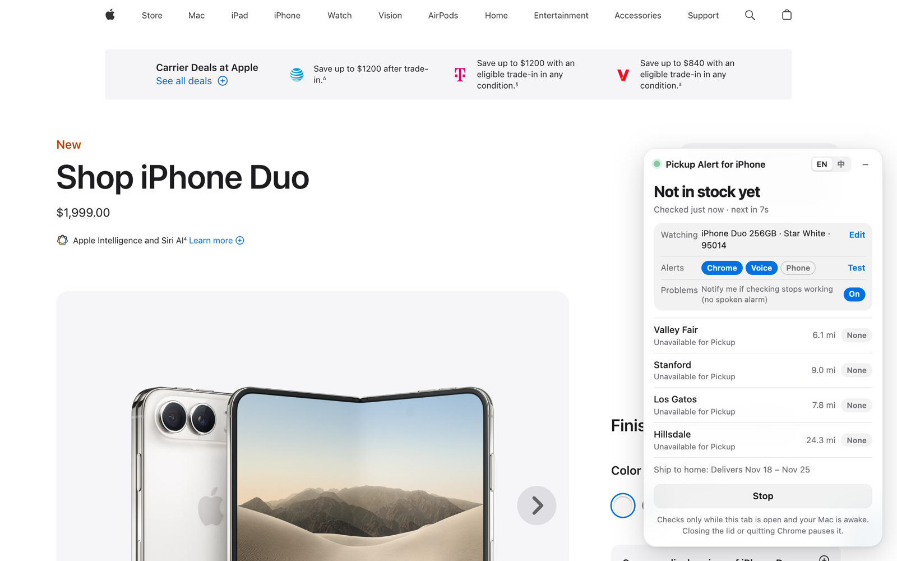
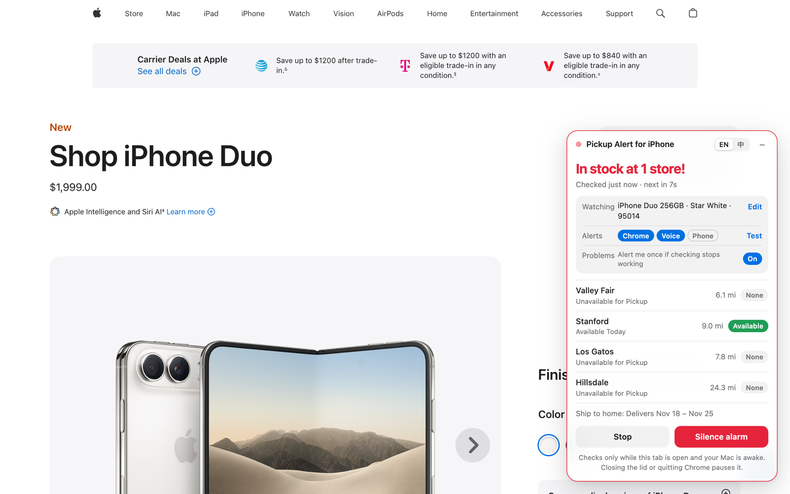
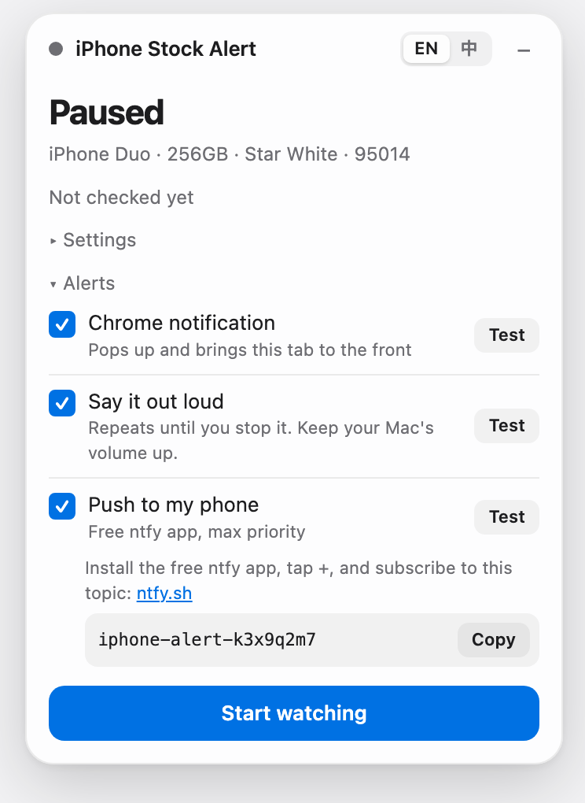

#  Pickup Alert for iPhone

Pick the iPhone you want and get alerted the moment it's available for in-store pickup near you.

<picture>
  <source media="(prefers-color-scheme: dark)" srcset="docs/on-apple-dark.png">
  
</picture>

A small panel sits on Apple's own buy page and checks nearby stores about every 10 seconds, from **your own Chrome tab**, the same way you'd check by hand. It works on any iPhone buy page (iPhone Duo, iPhone 18 Pro, …), in English or 中文.

> Personal tool, not affiliated with or endorsed by Apple. iPhone is a trademark of Apple Inc. Apple can change or block its stock check at any time.

## Install

1. Get it from the **[Chrome Web Store](https://chromewebstore.google.com/detail/pickup-alert-for-iphone/ckmciiajjjgcddpdghkmpbljaeaeiemk)** and click **Add to Chrome**
2. Open the buy page for your iPhone, for example [iPhone Duo (US)](https://www.apple.com/shop/buy-iphone/iphone-duo) or [iPhone Duo (Canada)](https://www.apple.com/ca/shop/buy-iphone/iphone-duo)
3. In the panel, pick a model and enter your postal code, tap the alerts you want, then **Start watching**

Without the store: download [pickup-alert-for-iphone.zip](https://github.com/induction-axiom/pickup-alert-for-iphone/releases/latest/download/pickup-alert-for-iphone.zip), unzip it, then in `chrome://extensions` turn on **Developer mode**, click **Load unpacked** and pick the unzipped folder.

Leave that tab open in its own window. Any store Apple lists near your postal code counts, and the panel shows how far each one is.

**Each Apple tab is its own watch.** To watch two iPhones, open each one's buy page in its own tab and start both. A tab's model and alert choices stay with that tab (a refresh keeps them) and are gone when you close it; only your last postal code and phone topic are remembered.

When it shows up, the panel turns red and every alert you picked goes off:

<picture>
  <source media="(prefers-color-scheme: dark)" srcset="docs/in-stock-on-apple-dark.png">
  
</picture>

Screenshots show Apple's real buy page with example store results.

## Alerts

Tap **Chrome**, **Voice** or **Phone** in the panel to turn each one on or off, and **Test** to try the ones that are on. Nothing to install: it's all in the extension.

  <picture>
    <source media="(prefers-color-scheme: dark)" srcset="docs/alerts-dark.png">
    
  </picture>

| Alert | What happens | Setup |
|---|---|---|
| **Chrome notification** (on by default) | A notification that stays until clicked; the tab jumps to the front | None. If nothing pops up, allow Google Chrome in macOS System Settings → Notifications |
| **Say it out loud** (on by default) | Your Mac's voice repeats "iPhone … is in stock!" until you click **Silence alarm** or the notification | Keep the volume up and Mute off |
| **Push to my phone** | A max-priority push via the free [ntfy](https://ntfy.sh) app | Subscribe to the topic shown in the panel. It starts as a random UUID; you can paste your own or make a new one |

**Problems** (on by default): if checks keep failing for 5 minutes, the Mac was asleep, or a watching tab was closed, you're alerted once on the same alerts you picked for stock: the voice says it a single time instead of repeating, and it comes at most once an hour per tab. Turn it off in the panel to stay quiet, for example overnight.

## Keep it running

- **Updates and restarts don't stop it.** When the extension updates or Chrome reopens your tabs, a tab that was watching reloads and starts again by itself.
- **Keep the lid open.** A sleeping Mac checks nothing. While watching, the extension keeps the Mac awake (the screen can still turn off). If checks were paused anyway, the panel says for how long.
- **Keep Chrome from pausing the tab:** in `chrome://settings/performance`, add `apple.com` to *Always keep these sites active*.
- If Apple temporarily blocks checks (`HTTP 541`), the extension backs off on its own and recovers.

## Troubleshooting

| You see | Do this |
|---|---|
| `HTTP 541` | Usually nothing: Apple is rate-limiting, and checks slow down (up to 5 minutes apart) and recover by themselves. If it lasts for hours, Apple may have flagged this browser: click **Clear Apple cookies and retry** in the panel (this signs you out of apple.com). |
| The model list is empty | Apple changed its page. Please [open an issue](https://github.com/induction-axiom/pickup-alert-for-iphone/issues). |
| "Unrecognized response format" | Apple changed its page. Open DevTools → Console and look for `[Pickup Alert for iPhone] raw response`. |
| The voice test is silent | Turn the Mac's volume up and Mute off. |

Privacy: no server, no account, no analytics; see [PRIVACY.md](PRIVACY.md).

Developers: run tests with `node extension/test.js`; build the release zip with `scripts/package.sh`. Chrome Web Store listing material is in [store/](store/).
