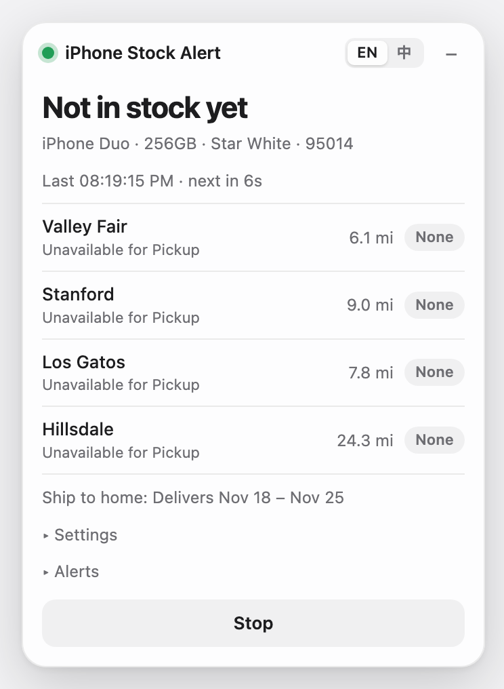
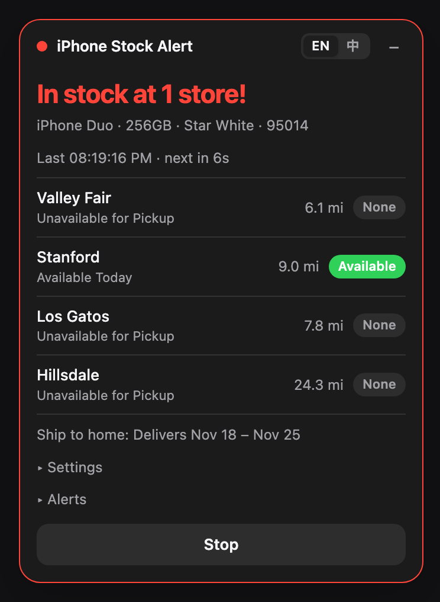
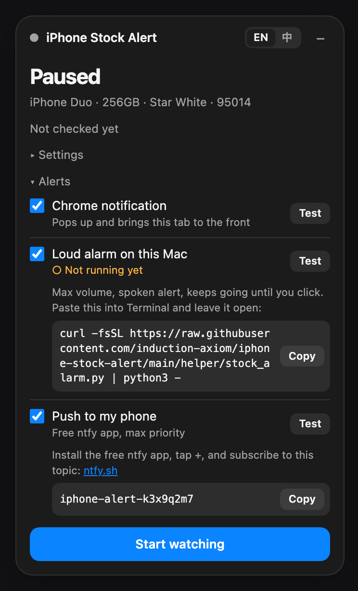

# iPhone Stock Alert

Pick the iPhone you want and get alerted the moment it's available for in-store pickup near you.

  
  &nbsp;
  

A small panel sits on Apple's own buy page and checks nearby stores about every 10 seconds, from **your own Chrome tab**, the same way you'd check by hand. It works on any iPhone buy page (iPhone Duo, iPhone 18 Pro, …), in English or 中文.

> Personal tool, not affiliated with Apple. Apple can change or block its stock check at any time.

## Install

1. Download this repo (**Code → Download ZIP**, then unzip)
2. Open `chrome://extensions`, turn on **Developer mode**, click **Load unpacked**, and pick the `extension` folder
3. Open the buy page for your iPhone, for example [iPhone Duo (US)](https://www.apple.com/shop/buy-iphone/iphone-duo) or [iPhone Duo (Canada)](https://www.apple.com/ca/shop/buy-iphone/iphone-duo)
4. In the panel: **Settings** → pick a model and enter your postal code; **Alerts** → choose how to be alerted; then **Start watching**

Leave that tab open in its own window. Any store Apple lists near your postal code counts, and the panel shows how far each one is.

## Alerts

Choose any combination in the panel. Each one has a **Test** button, and any setup it needs is shown right there.

  
  &nbsp;
  

| Alert | What happens | Setup |
|---|---|---|
| **Chrome notification** (on by default) | A notification that stays until clicked; the tab jumps to the front | None |
| **Loud alarm on this Mac** | Volume to max, a spoken alert on repeat, a dialog that stays until you click it. It also warns you out loud if monitoring stops | Paste the one-line command from the panel into Terminal |
| **Push to my phone** | A max-priority push via the free [ntfy](https://ntfy.sh) app | Subscribe to the topic shown in the panel |

## Keep it running

- **Keep the lid open.** A sleeping Mac checks nothing. The Mac alarm keeps the Mac awake while it runs, and the screen can still turn off.
- **Keep Chrome from pausing the tab:** in `chrome://settings/performance`, add `apple.com` to *Always keep these sites active*.
- If Apple temporarily blocks checks (`HTTP 541`), the extension backs off on its own and recovers.

## Troubleshooting

| You see | Do this |
|---|---|
| `HTTP 541` | Nothing. Apple is rate-limiting; checks slow down (up to 5 minutes apart) and recover by themselves. |
| The model list is empty | Enter the part number by hand (for example `MK1E4LL/A`). |
| "Unrecognized response format" | Apple changed its page. Open DevTools → Console and look for `[iPhone Stock Alert] raw response`. |
| Mac alarm says "Not running yet" | Run the command from the panel in Terminal and keep that window open. |

Developers: run tests with `node extension/test.js`; the Mac alarm is `helper/stock_alarm.py` (`--test` to hear it, `--dry-run` for silent mode).
